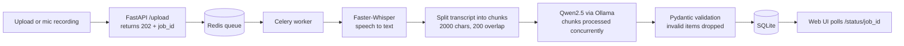

# Offline Meeting Intelligence Assistant

Turns meeting audio into a transcript and a validated list of action items (assignee, task, deadline, confidence), **entirely on your own machine**: no audio or text leaves the device.

## How it works



- **Non-blocking API:** uploads are streamed to disk with a size limit and queued; the client polls for progress (`transcribing`, `extracting`, `validating`).
- **Concurrent extraction:** transcript chunks are sent to the local LLM in parallel with `asyncio.gather()`.
- **Schema-validated output:** every extracted item must match a Pydantic schema (non-empty assignee and task, normalised deadline, confidence in 0 to 1). Invalid items are logged and discarded.
- **Confidence** is the score the LLM reports for each item. It is not a calibrated probability.
- **Failure handling:** Celery retries unexpected errors up to 3 times; bad input fails fast.

## Tech stack

Python, FastAPI, Celery, Redis (Docker), Faster-Whisper, Ollama (`qwen2.5`), httpx, Pydantic v2, SQLite, vanilla JS web UI.

## Quick start

Prerequisites: Python 3.9+, Docker (for Redis), [Ollama](https://ollama.com/).

```bash
git clone https://github.com/GunjanRoy4224/Offline-Meeting-Intelligence-Assistant.git
cd Offline-Meeting-Intelligence-Assistant
python -m venv venv && source venv/bin/activate      # Windows: venv\Scripts\activate
pip install -r requirements.txt
cp .env.example .env

docker-compose up -d                                  # Redis
ollama serve & ollama pull qwen2.5:latest             # local LLM
python -m uvicorn app.main:app --reload               # API + web UI at http://localhost:8000
celery -A workers.celery_app worker --loglevel=info   # worker (separate terminal)
```

## API

| Method | Path | Purpose |
|---|---|---|
| POST | `/upload` | Upload audio (mp3, wav, ogg, flac, m4a); returns `202` with `job_id` |
| GET | `/status/{job_id}` | Progress, transcript and extracted tasks |
| GET | `/health` | Liveness check |

```bash
curl -F "file=@meeting.wav" http://localhost:8000/upload
curl http://localhost:8000/status/<job_id>
```

## Configuration

Key variables in `.env` (see `.env.example`): `WHISPER_MODEL_SIZE` (default `base`), `WHISPER_DEVICE` (`cpu` or `cuda`), `OLLAMA_MODEL`, `OLLAMA_HOST`, `OLLAMA_TIMEOUT`, `MAX_UPLOAD_SIZE` (default 100 MB).

## Tests and benchmarking

```bash
pytest tests                                   # validation-layer unit tests (no GPU, Redis or Ollama needed)
python scripts/benchmark_upload.py --file path/to/sample.wav --requests 50 --concurrency 10
```

The benchmark script reports the latency of the `/upload` response (accept and enqueue). Run it on your machine; throughput scales with the number of Celery workers.

## Project structure

```text
app/        FastAPI app, config, models, static web UI
workers/    Celery tasks; processors for Whisper, Ollama and validation
data/       CLI recorder, sample-data and AMI corpus downloader
scripts/    benchmark_upload.py
tests/      pytest suite
```

## Limitations

- Extraction quality depends on the local model; a small model can miss or invent items.
- Confidence is LLM self-reported.
- Single-node SQLite; no authentication, so run it on a trusted network.
- Transcription language defaults to English (`WHISPER_LANGUAGE`).

## License

MIT
